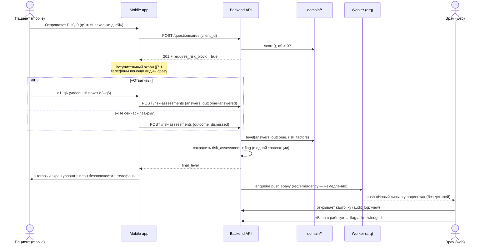
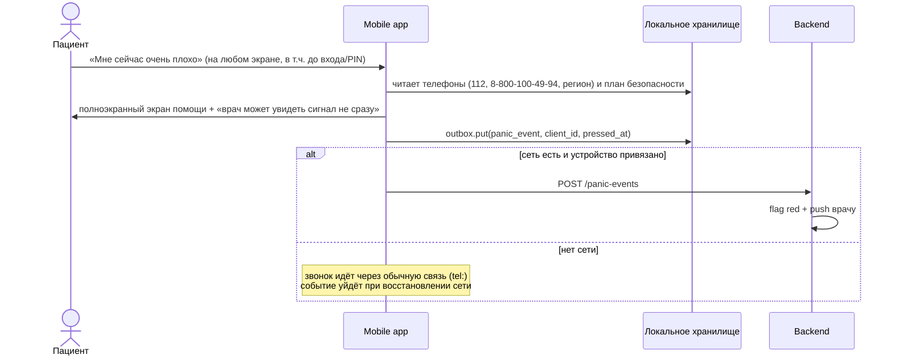
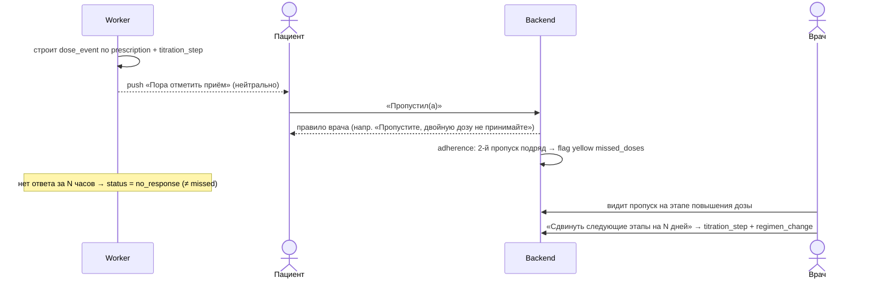

# Архитектура MVP — сервис наблюдения пациентов с тревожными и депрессивными расстройствами

> Прототип. Не предназначен для диагностики и лечения. Все данные демонстрационные.

Статус документа: **предложение на согласование** (26.10.2026).
Источник истины: «Приложение к Приложению — Полное Положение» (далее — Положение). Ссылки вида «§4.6» указывают на его разделы.

---

## 1. Ключевые архитектурные решения

| # | Решение | Почему |
|---|---------|--------|
| 1 | **Монорепозиторий**: `backend/` (FastAPI), `apps/web-doctor/` (Next.js 15), `apps/mobile/` (Expo), `content/` (клинический контент), `packages/` (общий TS-код) | Один PR меняет контент, бэкенд и клиентов согласованно |
| 2 | **Backend — FastAPI + SQLAlchemy 2 + Alembic + PostgreSQL 16**, фоновые задачи — **arq** (Redis) | Python-окружение уже есть; доменная логика — чистые функции, легко покрываются табличными тестами |
| 3 | **Вся клиническая логика — в слое `domain/` из чистых функций** без БД и I/O: подсчёт шкал, уровень суицидального риска, правила флагов, кризисные слова, взаимодействия, правило пропуска | Самое опасное место системы должно быть самым тестируемым. Никакого ML (§4.6) |
| 4 | **Клинический контент — данные, а не код**: тексты опросников, пороги, кризисные слова, телефоны, тексты [К], дерево ассистента, демо-база препаратов лежат в `content/*.json` с версиями и метаданными утверждения | §7.2: пороги «в конфигурацию, а не в код»; §5.4: тексты [К] хранятся с датой и ФИО утвердившего врача |
| 5 | **Общие тест-векторы** `content/test_vectors/*.json` прогоняются и в Python (сервер), и в TS (мобильное приложение) | Кризисные слова и экраны помощи нужны оффлайн → логика есть в двух языках; общие векторы не дают реализациям разойтись |
| 6 | **Ответы неизменяемы**: append-only записи + `supersedes_id` при повторном заполнении | §1.1: «отправленные ответы не редактируются… система хранит обе версии» |
| 7 | **Пропуск = `NULL`/отсутствие строки, никогда не 0** — на уровне схемы БД (nullable-поля, без DEFAULT) и графиков (разрыв линии) | §1.1, §4.3 |
| 8 | **Флаги — отдельная сущность с причиной и ссылкой на источник**; цвет пациента = максимум открытых флагов; закрывает флаг только врач | Врач видит *почему* пациент красный; сигнал не исчезает сам |
| 9 | **Мобильное приложение — offline-first**: SQLite + outbox с клиентскими UUID (идемпотентная синхронизация); экран помощи и план безопасности — в локальном хранилище, доступны до входа | §5.5: «без входа, без PIN, без интернета»; §5.7: дневник без интернета |
| 10 | **Нейтральные уведомления формируются на сервере**: в push-payload никогда не попадают названия препаратов/диагнозы, если пациент явно не включил подробности | §2.2, §5.3 |
| 11 | **Аудит-лог на уровне зависимостей FastAPI**: любой эндпоинт, читающий/меняющий данные пациента, обязан пройти через `audited_patient_access()` | §5.6, ст. 13 323-ФЗ — не полагаемся на дисциплину разработчика |
| 12 | **Пользователь без врача** — тот же мобильный клиент, режим `self_user`; врачебные модули скрыты, суицидальный протокол — только экран помощи | §3, §5.1 |

**Инфраструктура.** Для демо — `docker-compose` (PostgreSQL, Redis, backend, worker, web). Для пилота — хостинг в РФ (Yandex Cloud / Selectel), шифрование дисков, TLS везде, прикладное шифрование особо чувствительных полей (свободный текст, план безопасности) ключом из KMS, бэкапы. В альфа-версии реальных ПДн нет (§7.9).

---

## 2. Структура репозитория

```
applicationcase/
├── docs/
│   ├── ARCHITECTURE.md            ← этот документ
│   └── adr/                       ← записи архитектурных решений
├── content/                       ← клинический контент (единственный источник)
│   ├── instruments/
│   │   ├── phq9.ru.v1.json        ← дословно §4.4 (Pfizer)
│   │   ├── gad7.ru.v1.json        ← дословно §4.5 (Золотарева 2023)
│   │   ├── diary.ru.v1.json       ← §4.3
│   │   └── suicide_block.ru.v1.json ← §7.1 (вступление, 6 вопросов, итоговые экраны)
│   ├── thresholds.json            ← §7.2
│   ├── crisis_words.ru.json       ← §7.4
│   ├── alarming_symptoms.ru.json  ← §7.5
│   ├── side_effects.ru.json       ← список §4.3 в.8 и §5.4 блок 2
│   ├── help_phones.json           ← §7.6 (+ дата проверки)
│   ├── approved_texts.ru.json     ← §7.3, тексты [К] с полями утверждения
│   ├── assistant_tree.ru.json     ← §5.4: блоки 1–9, кнопки, источник [Д/И/К/В]
│   ├── drugs_demo.json            ← §7.8: 8 препаратов + вспомогательные вещества
│   ├── interaction_rules.json     ← §7.8: правила взаимодействий
│   ├── icd10_subset.json          ← F32, F33, F41.1 и др. (заменяемый справочник)
│   ├── specialists_demo.json      ← §3.2 демо-каталог
│   ├── demo_seed/                 ← §7.13: Анна, Игорь, Мария, Олег
│   └── test_vectors/              ← общие кейсы для Python и TS
│       ├── scoring.json
│       ├── risk_levels.json
│       ├── crisis_words.json
│       ├── flags.json
│       └── interactions.json
├── backend/
│   ├── pyproject.toml
│   ├── alembic/                   ← миграции
│   ├── app/
│   │   ├── main.py
│   │   ├── core/                  ← config, security (JWT, TOTP), crypto, audit, deps
│   │   ├── content/               ← загрузка и валидация content/*.json (pydantic)
│   │   ├── domain/                ← ЧИСТЫЕ ФУНКЦИИ, без БД
│   │   │   ├── scoring.py         ← PHQ-9/GAD-7, интерпретации, мягкие тексты
│   │   │   ├── risk_protocol.py   ← уровень реагирования, эскалация факторами риска
│   │   │   ├── crisis_words.py    ← нормализация, основы слов, 1 опечатка
│   │   │   ├── flag_rules.py      ← все правила §1.1 → список FlagCandidate
│   │   │   ├── unscheduled_check.py ← компонент 4 §4.6
│   │   │   ├── adherence.py       ← статусы приёма, «подряд», %
│   │   │   ├── missed_dose.py     ← правило при пропуске → текст
│   │   │   ├── titration.py       ← расписание доз, ручной сдвиг этапов
│   │   │   ├── interactions.py    ← проверка сочетаний, «данных нет» по умолчанию
│   │   │   ├── diary_window.py    ← «задним числом до 12:00», таймзоны
│   │   │   └── self_check.py      ← §3.1 рекомендации пользователю
│   │   ├── models/                ← SQLAlchemy-модели
│   │   ├── schemas/               ← Pydantic DTO
│   │   ├── services/              ← оркестрация: сохранить → пересчитать флаги → уведомить
│   │   ├── api/                   ← роутеры: auth, link, consent, diary, questionnaires,
│   │   │                             risk, panic, safety_plan, regimen, doses, labs,
│   │   │                             side_effects, messages, assistant, flags, catalog, sync
│   │   ├── workers/               ← arq: напоминания, «нет ответа», «нет данных 7 дней»,
│   │   │                             пропуск еженедельного опросника
│   │   └── seed/                  ← загрузка демо-данных
│   └── tests/
│       ├── domain/                ← табличные тесты + test_vectors
│       ├── api/                   ← интеграционные (реальный PostgreSQL)
│       └── scenarios/             ← сквозные сценарии §7.13
├── packages/
│   ├── domain-ts/                 ← TS-порт: crisis_words, scoring, risk_protocol, self_check
│   └── api-client/                ← типы и клиент, генерируются из OpenAPI
├── apps/
│   ├── web-doctor/                ← Next.js 15 (App Router) + Tailwind + shadcn/ui + Recharts
│   └── mobile/                    ← Expo (React Native) + expo-router + expo-sqlite
└── infra/
    ├── docker-compose.yml
    └── .env.example
```

---

## 3. Сущности и ER-диаграмма

### 3.1. Группы сущностей

**Доступ и право**
- `account` — учётная запись: роль (`doctor` | `patient` | `self_user`), телефон/e-mail, для врача — хеш пароля и TOTP-секрет (зашифрован).
- `doctor_profile` — ФИО, специальность, таймзона, рабочие часы, срок ответа, окно push о красных флагах.
- `patient_profile` — ФИО, дата рождения, пол, город (→ региональный телефон), таймзона, время дневника, тихие часы, `notification_details_enabled` (по умолчанию `false`), `takes_medication`.
- `care_link` — привязка пациент ↔ врач: код-приглашение, QR, срок действия, статус. Уникально одна активная связь на пациента (§5.2).
- `consent` — согласие на обработку данных о здоровье: версия текста, дата, способ, дата отзыва.
- `refresh_token`, `device` (push-токен), `audit_log` (append-only).

**Справочники (загружаются из `content/`)**
- `icd_code` (код, название, версия классификации — заменяемо на МКБ-11).
- `instrument` (PHQ9, GAD7, DIARY, SRB) с версией и полным текстом — ответы ссылаются на версию.
- `substance` — препараты из демо-базы и вещества для проверки взаимодействий (трамадол, триптаны, ципрофлоксацин, ингибиторы МАО, зверобой, аспирин/НПВС/варфарин, опиоиды, алкоголь) с классами (`ssri`, `snri`, `maoi`, `benzo`…), разделами инструкции и правилом пропуска по умолчанию.
- `interaction_rule` — селекторы A/B (по веществу или классу), уровень (`red` | `yellow` | `info`), текст, «вопрос врачу».
- `approved_text` — ключ, версия, текст, статус (`draft` | `approved`), ФИО утвердившего, дата утверждения, дата пересмотра.
- `help_phone`, `alarming_symptom`, `threshold`, `specialist_demo`.

**Наблюдение**
- `diary_entry` — дневник за день: все 8 показателей nullable, `filled_late`, `client_id` (UUID для синхронизации), `supersedes_id`.
- `diary_side_effect` — отмеченные в вопросе 8 эффекты.
- `questionnaire_schedule` — слоты еженедельных опросников: срок, статус (`pending` | `reminded` | `done` | `missed`).
- `questionnaire_submission` — PHQ-9 или GAD-7: версия инструмента, контекст (`weekly` | `self_check`), сумма, вопрос о трудностях (PHQ-9), `supersedes_id`.
- `questionnaire_answer` — ответ на каждый пункт (0–3).
- `risk_assessment` — уточняющий блок: триггер и ссылка на источник, ответы q1–q6 (nullable), исход (`answered` | `dismissed` | `partial`), базовый уровень, флаг эскалации факторами риска, итоговый уровень.
- `risk_factors` — исходные факторы риска (компонент 1), заполняет врач.
- `panic_event` — нажатие тревожной кнопки: время на устройстве и время получения сервером.
- `safety_plan` — версии плана безопасности (сигналы, способы справиться, люди, специалисты, ограничение доступа к опасным средствам), отметка просмотра врачом.
- `side_effect_report` — журнал побочных эффектов (из дневника или ассистента), признак «новый», ссылка на тревожный симптом.

**Лечение**
- `diagnosis` — диагноз пациента (код МКБ, кто/когда установил).
- `prescription` — назначение: препарат (МНН + торговое название), форма, доза, время и кратность, указания, даты, правило пропуска (`take_if_more_than_hours` + N | `skip_no_double` | `contact_doctor`), **дата очного приёма**, на котором сделано назначение (ст. 36.2 323-ФЗ).
- `titration_step` — этапы титрации (дата, доза).
- `regimen_change` — история изменений: кто, когда, тип, `before`/`after` (JSON), причина. Она же — вертикальные отметки на графиках.
- `dose_event` — конкретный приём по расписанию: статус (`pending` | `taken` | `taken_late` | `missed` | `self_changed` | `no_response`), время ответа, фактическая доза.
- `other_medication` — препараты от других врачей / безрецептурные / БАД.
- `lab_order`, `lab_event` — анализы и их напоминания (включая график печёночных проб для агомелатина).

**Связь**
- `message` — сообщения пациент ↔ врач: происхождение (блок 7 / блок 9 / «Всё равно хочу спросить» / передача от ассистента), текст ≤ 500 знаков, статус (`new` | `read` | `answered`), `crisis_match`. Не удаляются.
- `attachment` — только блок 9, изображения/PDF ≤ 10 МБ.
- `assistant_interaction` — история нажатий кнопок ассистента: кнопка, источник ответа, «помогло»/«к врачу» (врач видит историю).

**Флаги и уведомления**
- `flag` — пациент, уровень (`red` | `yellow`), код причины, тип и id источника, статус (`open` | `acknowledged`), кто/когда закрыл, `dedupe_key`.
- `notification` — получатель, тип, нейтральный текст, подробный текст (если разрешён), когда отправить, статус.

### 3.2. ER-диаграмма ключевых таблиц

```mermaid
erDiagram
    account ||--o| doctor_profile : "роль doctor"
    account ||--o| patient_profile : "роль patient / self_user"
    account ||--o{ consent : даёт
    account ||--o{ audit_log : "действует (actor)"

    doctor_profile ||--o{ care_link : ведёт
    patient_profile ||--o| care_link : "одна активная"

    patient_profile ||--o{ diagnosis : имеет
    patient_profile ||--o| risk_factors : "исходные факторы"
    patient_profile ||--o{ safety_plan : "версии плана"

    patient_profile ||--o{ diary_entry : заполняет
    diary_entry ||--o{ diary_side_effect : содержит
    diary_entry |o--o| diary_entry : supersedes

    patient_profile ||--o{ questionnaire_schedule : "слоты раз в 7 дней"
    questionnaire_schedule |o--o{ questionnaire_submission : закрывает
    patient_profile ||--o{ questionnaire_submission : проходит
    questionnaire_submission ||--|{ questionnaire_answer : "ответ на каждый пункт"
    questionnaire_submission |o--o| risk_assessment : "q9 > 0 запускает"

    patient_profile ||--o{ risk_assessment : проходит
    patient_profile ||--o{ panic_event : нажимает

    patient_profile ||--o{ prescription : получает
    substance ||--o{ prescription : "МНН"
    prescription ||--o{ titration_step : этапы
    prescription ||--o{ regimen_change : история
    prescription ||--o{ dose_event : "приёмы по расписанию"
    patient_profile ||--o{ other_medication : "от других врачей"
    substance ||--o{ interaction_rule : "селектор A/B"

    patient_profile ||--o{ side_effect_report : журнал
    patient_profile ||--o{ lab_order : назначено
    lab_order ||--o{ lab_event : напоминания

    patient_profile ||--o{ message : переписка
    message ||--o{ attachment : "только блок 9"
    patient_profile ||--o{ assistant_interaction : "история вопросов"

    patient_profile ||--o{ flag : "флаги срочности"
    account ||--o{ notification : получает

    questionnaire_submission {
        uuid id PK
        uuid patient_id FK
        text instrument "PHQ9 | GAD7"
        text instrument_version
        text context "weekly | self_check"
        smallint total_score
        smallint difficulty "только PHQ-9, nullable"
        uuid supersedes_id FK
        timestamptz submitted_at
    }
    questionnaire_answer {
        uuid submission_id FK
        smallint item_no "1..9 / 1..7"
        smallint value "0..3"
    }
    diary_entry {
        uuid id PK "клиентский UUID"
        uuid patient_id FK
        date day "в таймзоне пациента"
        smallint mood "0..10, nullable, без default"
        smallint interest
        smallint anxiety
        smallint worry_control
        numeric sleep_hours "шаг 0.5"
        smallint sleep_quality
        smallint energy
        text meds_taken "all | missed | self_changed | null"
        bool had_side_effects
        bool filled_late
        uuid supersedes_id FK
    }
    risk_assessment {
        uuid id PK
        uuid patient_id FK
        text trigger "phq9_q9 | unscheduled | crisis_words | ..."
        uuid trigger_ref
        bool q1_passive
        bool q2_active
        bool q3_method
        bool q4_intent
        bool q5_plan
        bool q6_behavior
        text outcome "answered | dismissed | partial"
        text base_level "yellow | red | emergency"
        bool escalated_by_risk_factors
        text final_level
    }
    prescription {
        uuid id PK
        uuid patient_id FK
        uuid substance_id FK
        text trade_name
        numeric dose
        text unit
        text[] times
        text missed_dose_rule
        smallint missed_dose_hours
        date in_person_visit_date
        date start_date
        date end_date
    }
    dose_event {
        uuid id PK
        uuid prescription_id FK
        timestamptz scheduled_at
        numeric planned_dose
        text status "pending | taken | taken_late | missed | self_changed | no_response"
        timestamptz responded_at
        numeric actual_dose
    }
    flag {
        uuid id PK
        uuid patient_id FK
        text level "red | yellow"
        text reason "см. 4.2"
        text source_type
        uuid source_id
        text status "open | acknowledged"
        uuid acknowledged_by FK
        timestamptz created_at
        text dedupe_key
    }
    audit_log {
        bigint id PK
        timestamptz at
        uuid actor_id FK
        text action "view | create | update"
        text entity
        uuid entity_id
        uuid patient_id
    }
```



---

## 4. Ядро безопасности: правила

### 4.1. Уровень реагирования уточняющего блока (`domain/risk_protocol.py`)

```
если outcome = dismissed (нажато «Не сейчас» / блок закрыт)  → base = RED
иначе:
  если q4 или q5 или q6 = да                              → base = EMERGENCY
  иначе если q2 = да (q3 не влияет без q4/q5)              → base = RED
  иначе если q1 = да                                       → base = YELLOW
  иначе (все «нет», но q9 PHQ-9 > 0)                       → base = YELLOW  ⚠ вопрос В1
если outcome = partial → base = max(base по отвеченным, RED)
если есть исходные факторы риска → final = на ступень выше (EMERGENCY — потолок)
```

Вне зависимости от уровня: показывается план безопасности и телефоны, врачу уходит флаг (жёлтый → `yellow`, красный/экстренный → `red` + срочный push). Слов «низкий риск» в продукте нет — ни в текстах, ни в enum-ах, доступных клиенту.

### 4.2. Флаги (`domain/flag_rules.py`)

| Код причины | Уровень | Условие | Когда пересчитывается |
|---|---|---|---|
| `risk_block_red`, `risk_block_emergency` | red | уровень блока red/emergency | отправка/закрытие блока |
| `risk_block_dismissed` | red | блок закрыт без ответа | закрытие |
| `panic_button` | red | нажата тревожная кнопка | получение события |
| `crisis_words` | red | совпадение в свободном тексте | сообщение |
| `alarming_symptom` | red/yellow | по таблице §7.5 (акатизия — жёлтый) | отчёт о побочном эффекте |
| `risk_block_passive` | yellow | уровень блока yellow | отправка блока |
| `phq9_increase` | yellow | рост ≥ 5 к предыдущему заполнению | отправка PHQ-9 |
| `gad7_increase` | yellow | рост ≥ 4 | отправка GAD-7 |
| `missed_doses` | yellow | ≥ 2 `missed` подряд по одному препарату | ответ на приём |
| `self_dose_change` | yellow | статус `self_changed` | ответ на приём / дневник |
| `low_mood_streak` | yellow | mood ≤ 3 три **календарных** дня подряд (пропущенный день рвёт серию) | отправка дневника |
| `new_side_effect` | yellow | эффект, которого не было в журнале | дневник / ассистент |
| `no_data_7d` | yellow | нет ни одной записи пациента 7 дней | воркер раз в час |

Все пороги читаются из `threshold` (§7.2). Повторные срабатывания одной причины не плодят флаги (`dedupe_key`). Список врача сортируется: открытые красные (новые сверху) → жёлтые → зелёные.

### 4.3. Кризисные слова (`domain/crisis_words.py` + `packages/domain-ts`)

Нормализация: нижний регистр, `ё→е`, удаление пунктуации → токены → сравнение по основе (стемминг Snowball для русского) для однословных и многословных выражений, расстояние Дамерау–Левенштейна ≤ 1 для слов длиннее 6 букв. Отрицание срабатывание **не** отменяет (§7.4). Проверка выполняется на клиенте (мгновенно открыть экран помощи, в т. ч. оффлайн) и повторно на сервере (флаг врачу — авторитетный источник).

---

## 5. Критические сценарии

### 5.1. PHQ-9, вопрос 9 > 0 → уточняющий блок → флаг



Если сеть недоступна: результат уровня считается на устройстве (`domain-ts`), экраны показываются сразу, отправка — из outbox при появлении сети. Сервер пересчитывает уровень сам и не доверяет клиентскому.

### 5.2. Тревожная кнопка (без входа, без интернета)



План безопасности и телефоны хранятся локально в зашифрованном виде; ключ доступен без PIN, потому что экран помощи обязан открываться без PIN. Компромисс осознанный: план безопасности не содержит назначений и диагноза.

### 5.3. Свободный текст → кризисные слова

Клиент: проверка → при совпадении сразу экран помощи, затем отправка. Сервер: сохраняет сообщение (доставка врачу как обычно) → повторная проверка → `message.crisis_match = true` → флаг `crisis_words` (red) → push врачу.

### 5.4. Напоминание о приёме → пропуск → правило врача → флаг



Автоматического сдвига этапов нет (§1.3) — только ручная кнопка врача.

---

## 6. Клиенты

**Кабинет врача (Next.js 15).** Вход: пароль + TOTP, автовыход при бездействии. Экраны: очередь пациентов по флагам; карточка (графики дневника неделя/месяц/всё с разрывами и вертикальными отметками изменений схемы, PHQ-9/GAD-7 по неделям с ответами по пунктам, приверженность %, пропуски, журнал побочных эффектов, ответы уточняющего блока, факторы риска, план безопасности, история вопросов ассистенту); схема лечения и титрация; анализы; сообщения (новое → прочитано → отвечено); создание пациента и код/QR приглашения. Уведомления врачу — PWA Web Push + живое обновление (SSE) для демо.

**Мобильное приложение (Expo).** Тревожная кнопка на каждом экране. Пациент: «Сегодня» (приёмы, дневник, опросник, анализ), дневник (слайдеры без значения по умолчанию), опросники, «Мой прогресс» (мягкие формулировки §7.3 + пометка «не диагноз»), «Мой план лечения», ассистент, план безопасности, настройки (время дневника, тихие часы, подробные уведомления, согласие). Пользователь: самопроверка (не чаще 1 раза в 14 дней), рекомендации §3.1, «кто есть кто», демо-каталог. Стартовый экран — дисклеймер прототипа. Красный цвет и тревожные значки — только на экране помощи (§5.7).

**Метки утверждения.** Каждый медицинский текст рендерится с подписью из `approved_text`: «Утверждено: ФИО, дата» или, если статус `draft`, — «Проект текста для демонстрации, требует утверждения врачами команды».

---

## 7. Тестирование

| Уровень | Что | Инструменты |
|---|---|---|
| Доменные правила | Подсчёт шкал, все ветки уровня риска (вкл. dismissed/partial/эскалацию), каждое правило флага, кризисные слова (формы, ё, опечатки, отрицания), взаимодействия (вкл. «нет в базе → данных нет»), окно «задним числом» с таймзонами, титрация | pytest, табличные тесты на `content/test_vectors` |
| Паритет Python ↔ TS | Те же test_vectors для `packages/domain-ts` | Vitest |
| Контент | Дословность PHQ-9/GAD-7 (снапшот-тест против эталона), все кнопки ассистента имеют источник, у [К]-текстов есть метаданные утверждения, в нейтральных уведомлениях нет названий препаратов | pytest |
| API | Транзакционность «оценка + флаг», неизменяемость ответов, идемпотентность синхронизации, аудит на каждом чтении, доступ только лечащего врача | pytest + реальный PostgreSQL |
| Сценарии | 4 персонажа §7.13: порядок Мария → Игорь → Анна, флаги и экраны | pytest (API) + Playwright (кабинет) |
| Мобайл | Экран помощи рендерится без авторизации и без сети; уточняющий блок закрывается и всё равно даёт флаг | Jest + React Native Testing Library |

---

## 8. План реализации (после согласования)

1. Каркас монорепо, `content/` с валидацией, модели + миграции Alembic, сиды демо-данных.
2. `domain/risk_protocol`, `crisis_words`, `flag_rules` + сервис флагов + тесты.
3. Дневник, PHQ-9/GAD-7, расписание опросников, воркеры напоминаний.
4. Схема лечения, титрация, приёмы, приверженность, правило пропуска, история изменений.
5. Кабинет врача: очередь + карточка + графики.
6. Мобильный UI пациента и пользователя.
7. Тревожная кнопка, экраны помощи, план безопасности (оффлайн).
8. Ассистент (дерево §5.4, взаимодействия §7.8).

---

## 9. Вопросы, которые не закрыты Положением

Предлагаемые значения по умолчанию — в скобках. Без ответа реализую их, вынеся в `thresholds.json`/контент с пометкой «требует утверждения врачами».

| # | Вопрос | Предложение |
|---|---|---|
| В1 | q9 PHQ-9 > 0, но в уточняющем блоке все шесть ответов «нет» — какой уровень? | **Жёлтый**: сигнал q9 не теряем, «низкий риск» не показываем |
| В2 | Повышают ли факторы риска уровень при закрытии блока без ответа (красный → экстренный)? | **Да**, единообразно |
| В3 | Блок заполнен частично и закрыт | max(уровень по ответам, красный) |
| В4 | Через сколько часов приём без ответа получает статус «Нет ответа»? | **3 часа** после времени приёма; отметить приём можно и позже |
| В5 | Компонент 4 §4.6: порог «выраженной бессонницы с высокой тревогой» и «чаще» после смены дозы | сон < 4 ч и тревога ≥ 7 три ночи подряд; блок раз в 3 дня в течение 14 дней после старта/смены дозы |
| В6 | Закрытие флагов | Только врач («Взял в работу»); `no_data_7d` закрывается сам при новых данных, но остаётся в истории |
| В7 | ФИО и дата для меток «утверждено врачами» | В альфе — статус `draft` и текст «Проект для демонстрации», пока не будут указаны ФИО |
| В8 | Канал push для врача | PWA Web Push; отдельное мобильное приложение врача — v2 |
| В9 | Локальная среда: Docker и PostgreSQL на машине не установлены | Поставить Docker Desktop (или PostgreSQL + Redis через Homebrew) |
